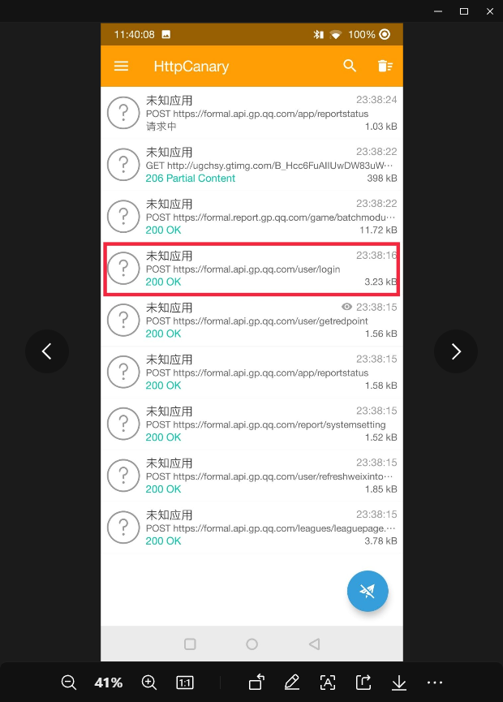
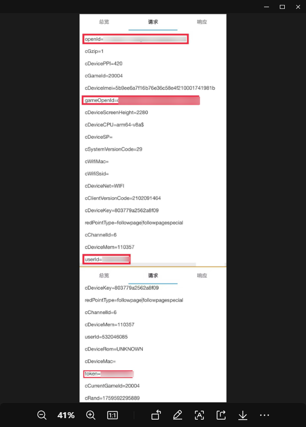

# 和平营地Token获取
> 用于和平营地自动签到等功能

> 💬 卡住了？直接进群问：**[¹Tloml-Starry 交流群](https://qun.qq.com/universal-share/share?ac=1&authKey=WOMji0R0sR013hTOeVlQjxNPlnNEethq%2Bbur4nu8y9vVMN8RLFZMoXPEShkPfSSR&busi_data=eyJncm91cENvZGUiOiIxMTA2NDAyMTU4IiwidG9rZW4iOiJYOFJOeUxrdU9haVZyQnVWM3lDYVJUd29QU2o2bTAwRDdWUUw4MDRFZXp3M2QyUEFpVDMyTXFFTFlCdy9GWUNZIiwidWluIjoiMzYyMDA2MDgyNiJ9&data=_jAbY2MUJJpEwQZV-E2EEF-a2tR7X5Zgx2yQl2gBpgqZm4DLK3lzevrQzAK5cvhpmo0rplUq7g3xsgKCrpJcHw&svctype=4&tempid=h5_group_info)**（群号 1106402158）

## 抓包前准备[>这里更详细](https://blog.csdn.net/2503_92066923/article/details/148075143)

1. 软件准备: 虚拟机，MT管理器，JustTrustMe， JustMeplush， JustMeAlreadly， HttpCanary， 和平营地
2. 打开HttpCanary导出SSL证书`证书选择Stem Trusted(.0)`
3. 将除虚拟机和HttpCanary外准备的软件导入虚拟机
   - 打开虚拟机的安卓9版本并开启root权限
   - 选择右下方导入按钮，找到需要导入的软件，和证书`证书在文件-内部存储-HttpCanary-cert中`
   - 导入之后，桌面上虚拟机桌面只会显示JustMePlush和MT管理器
4. 开始导入证书
   - 打开MT管理器，找到证书`证书在VMOSfiletransferstation文件夹`）`此时先在右半栏中找到etc/security/cacerts然后长按证书在跳出的功能面板中找到复制点击就会自行复etc/security/cacerts路径下

最后真机中打开HttpCanary进行抓包即可`切记: 在HttpCanary中把抓包目标应用设置为虚拟机`

---
> 下面进入抓包后的教程

1. 开启抓包之后切到和平营地后直接切回HttpCanary
2. 找到**https://formal.api.gp.qq.com/user/login**~~其实哪个都可以~~

图片

  </a>
    
  </a>

3. 打开点击`请求`，再点击`预览`
4. 找到**openId**，**gameOpenId**，**userId**，**token**并复制值

图片

  </a>
    
  </a>

5. 回到机器人，发送指令`#提交和平<openId>:<gameOpenId>:<userId>:<token>`
  - `#提交和平String:String:Number:String`